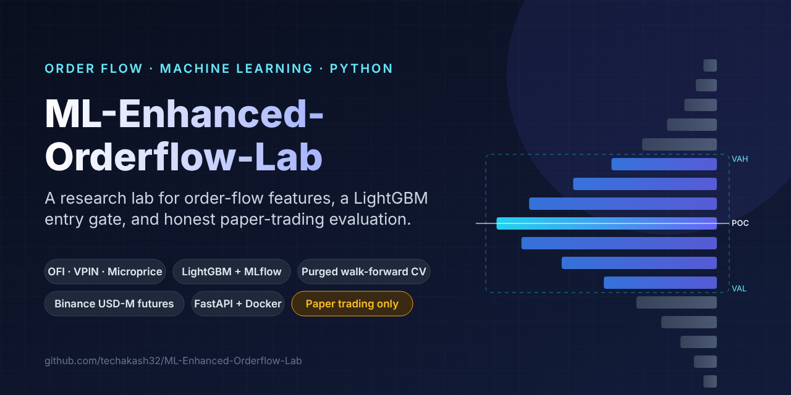
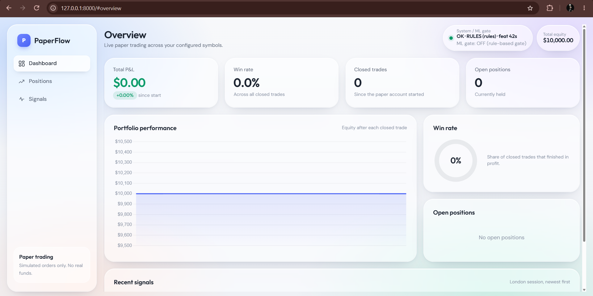
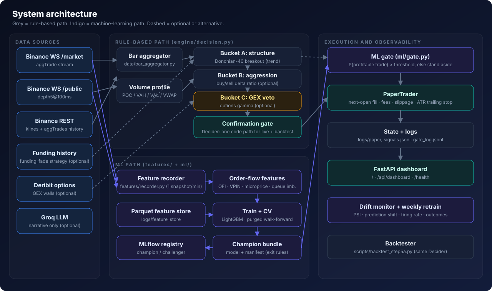
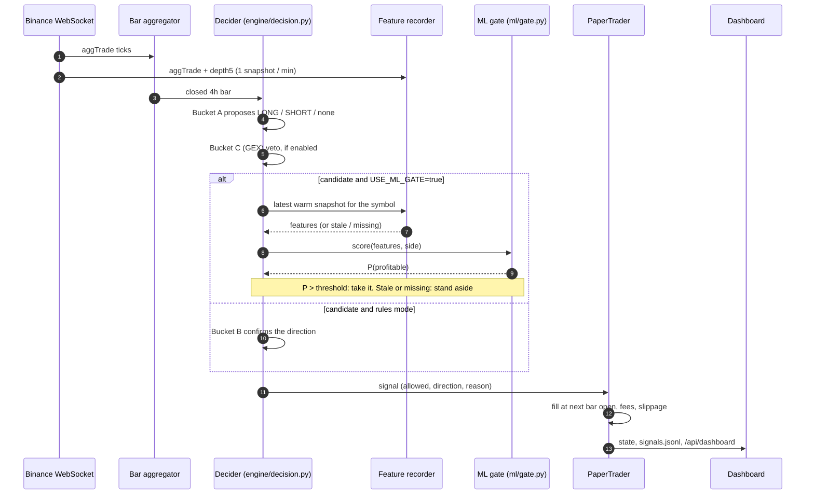
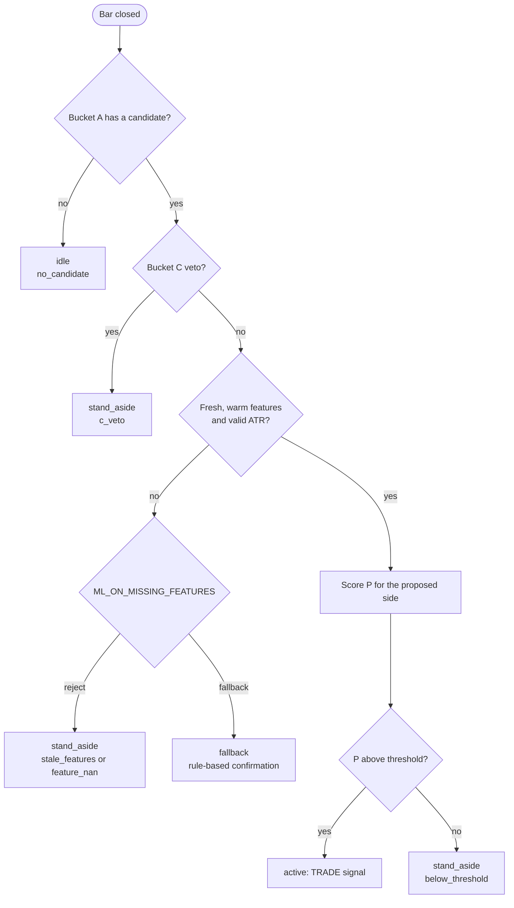
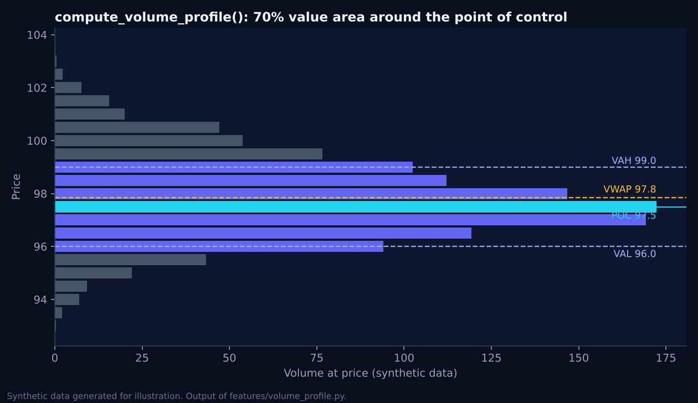
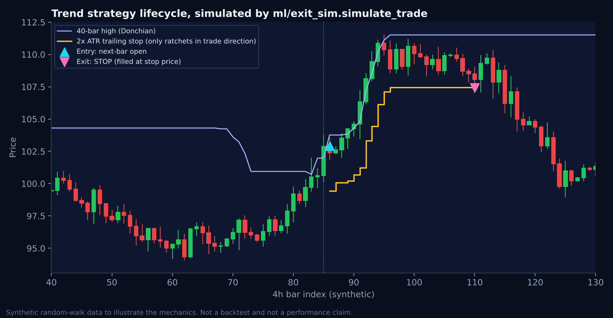
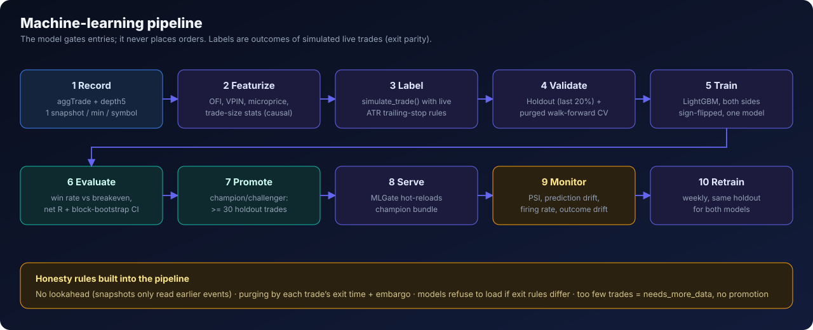
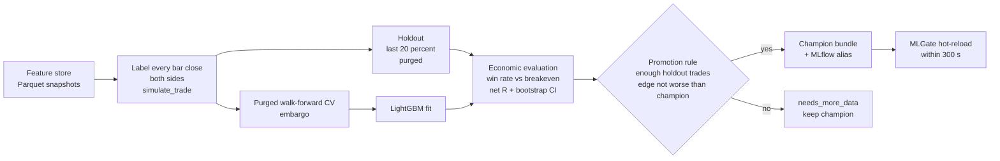
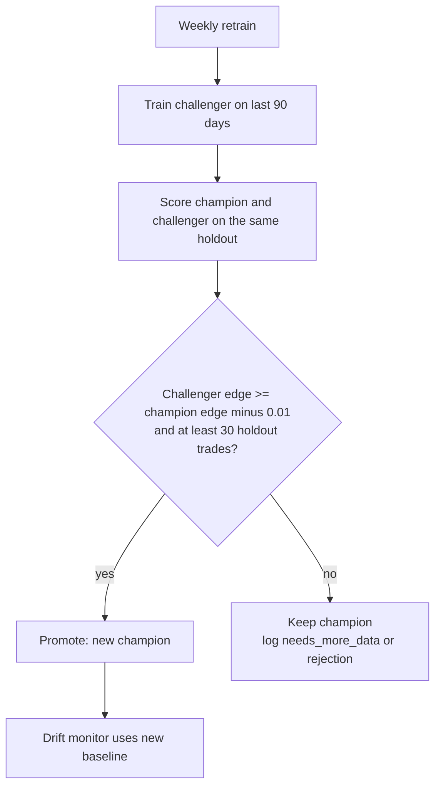

<div align="center">



# ML-Enhanced-Orderflow-Lab

**An open-source Python research lab for machine learning trading on crypto order flow: causal order-flow features, a LightGBM entry gate, purged walk-forward validation, and honest paper-trading evaluation on Binance USDⓈ-M futures.**

<p>
  
  
  
  
  
  
  
  <a href="https://github.com/techakash32/ML-Enhanced-Orderflow-Lab/stargazers"></a>
</p>

[Overview](#what-is-ml-enhanced-orderflow-lab) ·
[Features](#key-features) ·
[Architecture](#architecture) ·
[Quick start](#quick-start) ·
[ML pipeline](#machine-learning-pipeline) ·
[Backtesting](#backtesting-and-evaluation) ·
[FAQ](#frequently-asked-questions) ·
[References](#references-and-further-reading)

</div>

> **Paper trading only.** ML-Enhanced-Orderflow-Lab never places a real order on any exchange. It is research software, not financial advice. See the [disclaimer](#disclaimer).

---

## What is ML-Enhanced-Orderflow-Lab?

ML-Enhanced-Orderflow-Lab is a Python framework for **algorithmic trading research** on crypto perpetual futures. It records live **order flow** (aggressor-labelled trades and order-book depth) from Binance USDⓈ-M futures, turns it into causal **market microstructure** features, trains a **LightGBM** model to decide whether a rule-based breakout entry is worth taking, and evaluates the result by one question most backtests skip:

> *Does the strategy win more often than it needs to, after fees and slippage, and is that edge distinguishable from luck?*

The same decision code runs in the live paper trader and in the backtester, so a backtest trade is a live trade replayed on history.



<sub>The real dashboard (`python -m uvicorn scripts.dashboard:app`) on a fresh paper account. The status pill reads "ML gate: OFF (rule-based gate)" because no champion model has been trained yet.</sub>

### Why this project exists

- **Win rate alone is meaningless.** A 60% win rate loses money if wins are small and fees are large. This repo reports the **breakeven win rate** your exits and costs require, next to the observed one.
- **Most ML trading demos leak the future.** Here every feature is strictly causal, labels replay the real exit rules, and cross-validation purges overlapping trades.
- **Research and live code drift apart.** Here they share one `Decider` and one `PaperTrader`, and a test proves the label simulator matches the live trader.

### Who is it for?

Quant researchers and ML engineers who want a readable, tested reference for **order flow analysis** and **financial time series** modelling; algorithmic traders who want to paper-test ideas without risking capital; and developers learning how to build a trading research pipeline that is honest about its own uncertainty.

---

## Key features

| Area | What is implemented |
|---|---|
| **Order-flow features** | 28 causal features per snapshot: multi-level snapshot OFI, Cont-Kukanov-Stoikov event OFI (1m/5m), queue imbalance, microprice deviation and drift, VPIN with toxicity bands, trade-size statistics, large-trade share, multi-horizon returns, realised volatility (`features/orderflow.py`) |
| **Volume profile** | Point of control (POC), value area high/low (70%) and VWAP from per-price volume (`features/volume_profile.py`) |
| **Three-bucket confirmation gate** | A: structure/breakout, B: buy/sell aggression (optional), C: options-gamma (GEX) veto (optional) |
| **Four strategies** | `trend` (default, Donchian breakout), `sweep`, `absorption`, `funding_fade` |
| **ML entry gate** | LightGBM estimates P(profitable trade) for the proposed side; the trade is taken only if `P > ML_GATE_THRESHOLD`. Fails closed on stale features |
| **Label/exit parity** | Labels are outcomes of simulated *live* trades (ATR trailing stop, time stop, fees, slippage). `tests/test_exit_parity.py` replays paths through the real `PaperTrader` to prove equality |
| **Validation** | Time-based holdout, purged walk-forward CV with embargo, block-bootstrap confidence intervals, win rate vs breakeven win rate |
| **Backtester** | Win rate vs breakeven, exit distribution, gross vs net R with bootstrap CI, random-entry baseline, train/test split and parameter grid |
| **MLOps** | MLflow tracking and registry (SQLite, no server needed), champion/challenger promotion, hot-reload of the champion, weekly retraining |
| **Monitoring** | Drift checks (PSI, prediction shift, firing rate, outcome drift), gate-state reason codes, `/health` endpoint |
| **Paper execution** | Next-bar-open fills, taker/maker fees, slippage, one position at a time, state persisted to disk |
| **Dashboard** | FastAPI + Chart.js: equity curve, win rate, open positions, latest signals, gate and drift status |
| **Deployment** | Dockerfile, `docker-compose.yml`, Render blueprint, smoke-test script |
| **Optional LLM narrative** | Groq-generated rationale for each decision; off unless `GROQ_API_KEY` is set |

---

## Architecture



### How one trading decision is made



### Gate states you can observe

Every decision carries a `gate_state` and a `gate_reason`, shown on `/health` and in the dashboard. This is the ML-gate branch of `engine/decision.py`:



With no champion model, or with `USE_ML_GATE=false`, the state is simply `rules`.

---

## Visual showcase

<table>
<tr>
<td width="50%"></td>
<td width="50%"></td>
</tr>
<tr>
<td><sub><b>Volume profile.</b> Output of the repo's <code>compute_volume_profile()</code> on synthetic data.</sub></td>
<td><sub><b>Trend trade lifecycle.</b> Simulated by <code>ml/exit_sim.simulate_trade</code> on synthetic data. Illustrates mechanics, not performance.</sub></td>
</tr>
</table>

---

## How does order flow analysis work here?

**Order flow** is the stream of executed trades (labelled by who was the aggressor) and resting limit orders in the book. Price is the outcome; order flow is the process that produces it. ML-Enhanced-Orderflow-Lab uses it in two ways.

**1. Bar-level aggression (rule-based path).** `DeltaAccumulator` buckets trades into bars and tracks buy and sell volume. Bucket B turns recent delta and buy ratio into a LONG/SHORT/neutral vote.

**2. Microstructure features (ML path).** The recorder writes one snapshot per symbol per minute with 28 features:

| Group | Features | Idea |
|---|---|---|
| **Order flow imbalance (OFI)** | `ofi_snap_l5` (+z), `ofi_ev_1m`, `ofi_ev_5m` (+z) | Net pressure on the bid vs ask side of the book, including the event-based formulation of [Cont, Kukanov and Stoikov](https://arxiv.org/abs/1011.6402) |
| **Queue imbalance** | `qi_l1`, `qi_roc` | `(bid - ask) / (bid + ask)` at the best level, and its rate of change |
| **Microprice** | `micro_dev_bps`, `micro_dev_avg`, `micro_drift_bps` | Size-weighted mid-price vs mid-price |
| **VPIN** | `vpin`, `vpin_z`, `vpin_band`, `vpin_signed`, `vpin_age_s` | Volume-synchronised probability of informed trading ([Easley, López de Prado, O'Hara](https://papers.ssrn.com/abstract=1695596)). Aggressor side comes from the exchange, so no bulk classification is needed |
| **Trade statistics** | `tsize_mean/std/skew`, `large_vol_share`, `large_cnt_frac`, `large_net`, `trade_imb`, `trade_rate` | Trade-size distribution and large-trade direction |
| **Context** | `spread_bps`, `ret_15m/1h/4h`, `rvol_1h` | Liquidity, momentum, volatility |

Directional features flip sign for SHORT samples, so one model serves both sides.

**Causality contract.** A snapshot stamped *T* only sees events before *T*. Rolling statistics use only past data. Offline replay of the same event stream reproduces the same rows. This is covered by `tests/test_orderflow.py`.

### Volume profile, POC and value area

A **volume profile** aggregates traded volume by price. The **point of control (POC)** is the price with the most volume; the **value area** is the price range around it holding 70% of volume (**VAH** to **VAL**). `compute_volume_profile()` expands outward from the POC, adding whichever neighbouring price level has more volume until 70% is reached.

> **Footprint charts:** not implemented. `features/footprint.py` and `features/aggression.py` are empty placeholders. Bar-level buy/sell delta and the volume profile are what exists today.

---

## Machine learning pipeline





**Labels.** Each bar close is labelled for both sides with the net-R outcome of a simulated live trade: `+1` if above +0.10R, `-1` if below -0.10R, otherwise `0`.

**Why "exit parity" matters.** If a model is trained on a different exit rule than the bot runs, its probabilities describe a trade that never happens. The simulator reads parameters from `config/settings.py`, the same source `PaperTrader` uses; each model stores its `exit_rules` in `manifest.json`; and the live gate refuses to load a model whose rules differ. Details: [docs/PARITY_REPORT.md](docs/PARITY_REPORT.md).

**Fails closed.** Features older than `ML_MAX_FEATURE_AGE_S` (180 s) count as stale and the gate stands aside. With no model artifact, the system falls back to the rule-based gate and logs one warning.

---

## Strategy: the default trend profile

| Setting | Value |
|---|---|
| Timeframe | 4h bars |
| Entry signal (Bucket A) | Close breaks the prior 40-bar high (long) or low (short), Donchian-style |
| Session filter | Entries only when the fill bar opens 08:00-16:00 UTC (London) |
| Stop | 2x ATR(14), trailed after each completed bar |
| Target | None (trailing stop) |
| Time stop | After 90 bars |
| Sizing | 0.5% of equity risked per trade, from a $10,000 paper account |
| Symbols | BTCUSDT, ETHUSDT, XRPUSDT, ADAUSDT |
| Costs | Venue fee table (taker/maker) plus 0.04% slippage |

All of it is configurable through environment variables ([Configuration](#configuration)).

---

## Quick start

**Requirements:** Python 3.13 (the Dockerfile image; `pyproject.toml` allows 3.11+), and network access to Binance USDⓈ-M futures. Binance returns HTTP 451 to some regions including the US.

```bash
git clone https://github.com/techakash32/ML-Enhanced-Orderflow-Lab.git
cd ML-Enhanced-Orderflow-Lab

python -m venv .venv
source .venv/bin/activate          # Windows: .venv\Scripts\activate
```

Install dependencies. `requirements.txt` is UTF-16 and pins `pywin32`, which only exists on Windows:

```bash
# Windows
pip install -r requirements.txt

# Linux / macOS
iconv -f UTF-16 -t UTF-8 requirements.txt | tr -d '\r' | grep -vi '^pywin32' > requirements-unix.txt
pip install -r requirements-unix.txt
```

Run the tests (they use synthetic data and need no network):

```bash
python -m pytest tests -q
```

### Run the live paper trader

```bash
export ACTIVE_STRATEGY=trend BACKTEST_INTERVAL=4h BUCKET_B_ENABLED=false \
       TREND_LONDON_ONLY=true PAPER_SLIPPAGE_PCT=0.04 \
       SYMBOLS=BTCUSDT,ETHUSDT,XRPUSDT,ADAUSDT

python -m scripts.paper_live
```

On Windows PowerShell use `$env:NAME = "value"`. `paper_live` refuses to start if the configuration does not match this validated profile, so you never silently paper-trade the wrong settings.

### Run the dashboard

```bash
python -m uvicorn scripts.dashboard:app --host 0.0.0.0 --port 8000
```

Open <http://localhost:8000>. JSON feed: `/api/dashboard`. Health: `/health`.

### Run with Docker

```bash
docker build -t orderflow-lab .
docker run -p 8000:8000 -v orderflow_logs:/app/logs orderflow-lab
```

`start.sh` runs the paper trader, the feature recorder and the dashboard in one container. Mount `/app/logs` as a volume: paper-trading state, the feature store, models and MLflow runs all live there. `docker compose up --build` also starts the MLflow UI on port 5000.

### Run on Render

Create a Web Service from the repo with start command `bash start.sh`, choose a **non-US region** (Frankfurt or Singapore), and mount a persistent disk at `/app/logs`. See `render.yaml`.

---

## Backtesting and evaluation

```bash
# Quick look with an approximate volume profile
python -u -m scripts.backtest_step5a --vp approx --days 30

# Real per-price volume from Binance Vision aggTrades, fixed end date
python -u -m scripts.backtest_step5a --vp real --days 14 --end-date 2026-10-26

# Parameter grid with a train/test split by time
python -u -m scripts.backtest_step5a --vp real --days 14 --grid

# Override exits without editing settings.py
python -u -m scripts.backtest_step5a --vp real --days 14 \
  --stop 0.6 --target-r 1.5 --hold 90 --cooldown 15 --tag wide
```

Each run writes `summary_<tag>.json` and `trades_<tag>.jsonl` to `logs/backtest/`. The summary includes:

- **Win rate vs breakeven win rate** implied by the actual exits and fees
- **Exit distribution** (stop, time stop, target) and average R per exit type
- **Gross vs net R** with bootstrap 95% confidence intervals, to separate "no entry edge" from "edge eaten by fees"
- **Random-entry baseline**, to check the result beats chance

> `--vp approx` spreads each bar's volume evenly across its range, which behaves differently from live. Confirm anything promising with `--vp real`. The backtester always uses the rule-based gate because historical klines carry no order-book features.

---

## Model training and inference

Order-book history is not available from Binance, so training data is **recorded live**. Start recording first:

```bash
python scripts/verify_endpoints.py        # PASS/FAIL per WebSocket URL
python -m features.recorder --dry-run     # prints real messages, writes nothing
python -m features.recorder               # standalone recording (or set RECORD_FEATURES=true)
```

After roughly four weeks of recorded data (see the estimate in [docs/PARITY_REPORT.md](docs/PARITY_REPORT.md)):

```bash
python -m ml.train --report-trade-rate    # day-14 checkpoint: projected holdout trades
python -m ml.train --lookback-days 60     # label, purged CV, LightGBM, holdout, MLflow
python -m ml.retrain --dry-run            # full pipeline, no promotion, no history written
mlflow ui --backend-store-uri sqlite:///logs/ml/mlruns/mlflow.db --port 5000
```

Turn the gate on with `USE_ML_GATE=true`. A newly promoted champion is hot-reloaded within `ML_RELOAD_CHECK_S` (300 s) without a restart. The full guide, including weekly retraining, drift monitoring and deployment notes, is in [ML_README.md](ML_README.md).



### Drift monitoring

`python -m ml.monitor` runs hourly in `start.sh`. Baselines live in the champion's manifest.

| Check | Compared | Flag |
|---|---|---|
| Feature drift | PSI per feature, live vs training | PSI > 0.2 (0.1-0.2 = watch) |
| Prediction drift | Mean live P(favourable) vs holdout mean | abs(z) > 2 |
| Gate firing rate | Fraction of scores above threshold vs holdout | relative change > 50% |
| Outcome drift | Realised win rate of ML-gated paper trades vs holdout | holdout rate above the bootstrap CI (needs 10+ closed trades) |

---

## Configuration

Set these as environment variables. The complete list is in `config/settings.py`.

| Variable | Default | Purpose |
|---|---|---|
| `ACTIVE_STRATEGY` | `trend` | `trend`, `sweep`, `absorption` or `funding_fade` |
| `BACKTEST_INTERVAL` | `4h` | `5m`, `15m`, `1h`, `2h`, `4h`, `1d` |
| `SYMBOLS` | `BTCUSDT,ETHUSDT,XRPUSDT,ADAUSDT` | Traded Binance USDⓈ-M symbols |
| `VENUE` | `binance` | Fee table: `binance`, `bybit`, `okx`, `binance_vip`, `bybit_vip`, `zero_fee` |
| `PAPER_SLIPPAGE_PCT` | `0.04` | Slippage in percent |
| `TREND_DONCHIAN_LOOKBACK` | `40` | Breakout window in bars |
| `TREND_ATR_WINDOW` / `TREND_ATR_MULTIPLE` | `14` / `2.0` | ATR stop sizing |
| `TREND_LONDON_ONLY` | `true` | Restrict entries to London hours |
| `BUCKET_B_ENABLED` | `false` | Enable the order-flow aggression bucket |
| `USE_ML_GATE` | `false` (`true` in Docker) | Use the LightGBM gate instead of the rule-based confirmation |
| `ML_GATE_THRESHOLD` | `0.55` | Enter only if P(profitable) is above this |
| `ML_ON_MISSING_FEATURES` | `reject` | `reject` (stand aside) or `fallback` (rules) |
| `RECORD_FEATURES` | follows `USE_ML_GATE` | Run the order-flow feature recorder |
| `FEATURE_SYMBOLS` | 8 liquid perps in Docker | Symbols recorded for training (pooled model) |
| `MLFLOW_TRACKING_URI` | unset | e.g. `sqlite:///logs/ml/mlruns/mlflow.db` |
| `GROQ_API_KEY` | unset | Enables the optional LLM narrative |
| `FLASHALPHA_API_KEY` | unset | Optional GEX source for the Bucket C veto |

Never commit API keys. `.env` files are git-ignored.

---

## Technology stack

| Layer | Tools |
|---|---|
| Language | Python 3.13 |
| Market data | Binance USDⓈ-M futures WebSocket (`aggTrade`, `depth5@100ms`) and REST, Binance Vision aggTrades, Deribit options (optional GEX) |
| Data and features | NumPy, pandas, PyArrow (Parquet feature store) |
| Machine learning | LightGBM, scikit-learn, SciPy |
| Experiment tracking | MLflow (SQLite backend and model registry) |
| Service and UI | FastAPI, Uvicorn, Chart.js |
| Packaging | Docker, Docker Compose, Render |
| Quality | pytest (synthetic-data tests for causality, exit parity, labeling, monitoring, health, recorder) |

---

## Repository structure

```text
ML-Enhanced-Orderflow-Lab/
├── config/        settings.py (single source of truth), gate_params.yaml
├── data/          WebSocket manager, bar aggregation, delta accumulator, history, funding, Deribit GEX
├── features/      orderflow.py (28 causal features), volume_profile.py, recorder.py, store.py
├── gate/          bucket signals and the confirmation gate
├── engine/        decision.py (shared Decider), pipeline.py (live pipeline)
├── ml/            labeling, exit_sim, train, retrain, gate, monitor, metrics, registry, bundle
├── execution/     paper_trader.py (fills, fees, exits, persistence)
├── scripts/       paper_live, dashboard, backtest_step5a, verify_endpoints, health, smoke_deploy.sh
├── llm/           optional Groq narrative layer
├── dashboard/     single-page dashboard UI
├── tests/         pytest suite (synthetic data)
├── docs/          PARITY_REPORT.md, ML_LIVE_LOG.md, assets/ (README images)
├── Dockerfile · docker-compose.yml · render.yaml · start.sh
└── ML_README.md   full ML guide
```

`bars/` holds sample H4 CSVs (2023-2025) for several commodity and index symbols and `test/` holds early scratch copies of scripts; neither is used by the Binance pipeline described above.

---

## Performance: what is and is not verified

**No profitability claim is made.** There are no verified live or real-data backtest results for the ML gate yet: the first model needs about four weeks of recorded order-book data. The only ML numbers in the repository come from a synthetic dataset with a planted edge (see [docs/PARITY_REPORT.md](docs/PARITY_REPORT.md)); they prove the plumbing works, not that markets contain an edge. Treat any number you generate as a hypothesis, and read it against the confidence interval, the random baseline and the breakeven win rate.

## Limitations and known issues

- **Real-data validation of the ML gate has not been done.** No recorded order-book history exists until the recorder has run for weeks.
- **Few trades.** Donchian(40) breakouts in the London window are rare. Below 30 holdout trades no challenger is promoted (`needs_more_data`).
- **Overlapping labels.** A trade can last 90 bars, so the effective sample size is far below the row count.
- **Recorder endpoints** (`/market` and `/public` WebSocket paths) are documented as not yet verified against the live service. Run `scripts/verify_endpoints.py` first.
- **Paper fills are an approximation.** Next-open fills with fixed slippage; partial fills are not modelled.
- **Regional blocks.** Binance returns HTTP 451 from some regions.
- **Install friction.** `requirements.txt` is UTF-16 and contains a Windows-only pin (see Quick start).
- **Live execution does not exist.** `execution/live_trader.py` is an intentionally empty placeholder.

## Roadmap

- [x] Causal order-flow feature engine, recorder and Parquet store
- [x] Label/exit parity with a test against the real `PaperTrader`
- [x] Purged walk-forward CV, MLflow registry, champion/challenger retraining
- [x] Drift monitoring and gate-state observability
- [ ] Verify recorder endpoints and complete the first multi-week recording ([docs/ML_LIVE_LOG.md](docs/ML_LIVE_LOG.md))
- [ ] First real-data champion with confidence intervals
- [ ] Footprint (price-by-price bid/ask volume) features
- [ ] Add a license and a `requirements` file that installs on every OS
- [ ] Packaged examples and notebooks for the feature engine

---

## Frequently asked questions

### What is ML-Enhanced-Orderflow-Lab?
A Python research framework that records Binance futures order flow, builds causal microstructure features, trains a LightGBM entry gate, and evaluates it with paper trading and honest statistics.

### Does it trade real money?
No. Execution is paper-only and the live-trading module is empty by design.

### What is breakeven win rate?
The win rate a strategy needs just to cover its losses and fees, given its average win and loss size (`L / (W + L)`). If the observed win rate is below it, the strategy loses money even though it wins often.

### What is order flow imbalance (OFI)?
A measure of net buying vs selling pressure from changes at the best bid and ask. Cont, Kukanov and Stoikov showed it is linearly related to short-horizon price changes. See the [paper](https://arxiv.org/abs/1011.6402).

### What is VPIN?
Volume-synchronised probability of informed trading: an estimate of order-flow toxicity computed over equal-volume buckets ([paper](https://papers.ssrn.com/abstract=1695596)). Here the exchange-labelled aggressor side is used, so no trade classification is needed.

### What is a volume profile, POC and value area?
A histogram of volume by price. The point of control is the busiest price; the value area is the range holding 70% of volume.

### How does the ML model avoid lookahead bias?
Features are causal (a snapshot at time T sees only earlier events), labels replay the exact live exit rules, and validation uses a time-based holdout plus purged walk-forward CV with embargo, in the spirit of López de Prado's *[Advances in Financial Machine Learning](https://www.oreilly.com/library/view/advances-in-financial/9781119482086/)*.

### Does it include footprint charts?
Not yet. It has bar-level buy/sell delta and a volume profile; footprint features are on the roadmap.

### Can I use other exchanges or assets?
The data layer is built for Binance USDⓈ-M futures. Fee tables exist for Bybit and OKX, but data adapters do not.

### Can I add my own strategy?
Yes. Add a Bucket A evaluator in `engine/decision.py` and register the strategy name in `gate/confirmation_gate.py`.

### Why do I get HTTP 451 from Binance?
Binance blocks some regions, including US servers. Run from another region.

---

## Contributing

Issues and pull requests are welcome. For larger changes, please open an issue first. Before submitting, run `python -m pytest tests -q`, keep paper-only behaviour intact, and do not commit secrets. Good first areas: footprint features, cross-platform install, additional validation metrics, notebooks.

## Disclaimer

This software is provided for educational and research purposes only. It is **not** financial, investment or trading advice. Trading leveraged crypto derivatives carries a high risk of loss. Backtested and paper-traded results do not guarantee future performance. Use at your own risk; the authors accept no liability for any loss.

## License

No license file has been added yet, so all rights are reserved by the author by default. An open-source license (for example MIT or Apache-2.0) is planned so others can use and contribute; see [Choose a License](https://choosealicense.com/).

## References and further reading

- Cont, R., Kukanov, A., Stoikov, S. (2014). [The Price Impact of Order Book Events](https://arxiv.org/abs/1011.6402). *Journal of Financial Econometrics*.
- Easley, D., López de Prado, M., O'Hara, M. (2012). [Flow Toxicity and Liquidity in a High-Frequency World](https://papers.ssrn.com/abstract=1695596). *Review of Financial Studies*.
- López de Prado, M. (2018). [Advances in Financial Machine Learning](https://www.oreilly.com/library/view/advances-in-financial/9781119482086/). Wiley. (triple-barrier labels, purged cross-validation)
- Bailey, D., Borwein, J., López de Prado, M., Zhu, Q. [The Probability of Backtest Overfitting](https://papers.ssrn.com/abstract=2326253).
- [Binance USDⓈ-M Futures: Aggregate Trade Streams](https://developers.binance.com/docs/derivatives/usds-margined-futures/websocket-market-streams/Aggregate-Trade-Streams)
- [LightGBM documentation](https://lightgbm.readthedocs.io/en/latest/) · [MLflow Model Registry](https://mlflow.org/docs/latest/ml/model-registry)
- [Volume profile basics (TradingView)](https://www.tradingview.com/wiki/Volume_Profile)

## Author

Built by **Akash** ([@techakash32](https://github.com/techakash32)). Questions, ideas and bug reports: [open an issue](https://github.com/techakash32/ML-Enhanced-Orderflow-Lab/issues). If the project is useful to you, a star helps others find it.

---

<sub>**Topics:** machine learning trading, algorithmic trading, order flow analysis, quantitative trading, market microstructure, cryptocurrency market analysis, volume profile, trading signal analysis, Python trading framework, AI-powered trading research, financial time series analysis, LightGBM, MLflow, Binance futures, paper trading.</sub>
